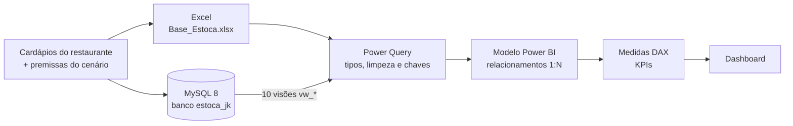
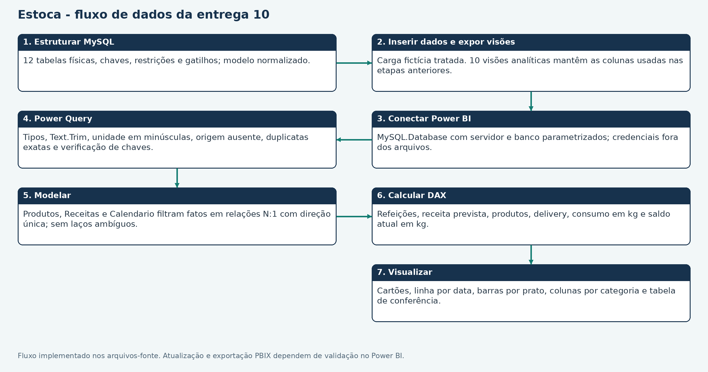

# ESTOCA — Seu estoque, sob controle

Sistema de controle de pequenos estoques aplicado ao **JK Bar e Restaurante**. O Estoca organiza produtos, receitas e movimentações, transforma a demanda prevista de refeições em necessidade de compra e apresenta os indicadores em um painel do Power BI.

> **Projeto Integrado (PI)** do módulo **Modelagem e Desenvolvimento de Sistemas** · UNIFEOB · 2º semestre de 2026
> Alinhado ao **ODS 12 da ONU — Consumo e Produção Responsáveis**


## Sumário

- [Situação-problema](#situação-problema)
- [Solução](#solução)
- [Impacto e ODS 12](#impacto-e-ods-12)
- [Arquitetura e fluxo dos dados](#arquitetura-e-fluxo-dos-dados)
- [Tecnologias](#tecnologias)
- [Como o projeto atende à orientação do PI](#como-o-projeto-atende-à-orientação-do-pi)
- [Indicadores do cenário](#indicadores-do-cenário)
- [Estrutura do repositório](#estrutura-do-repositório)
- [Como executar](#como-executar)
- [Testes e validação](#testes-e-validação)
- [Status e próximos passos](#status-e-próximos-passos)
- [Equipe](#equipe)

## Situação-problema

O JK Bar e Restaurante não possui controle de estoque. Sem uma lista confiável de insumos e sem o registro das entradas e saídas, fica difícil saber o que está disponível, quanto comprar e se o estoque atende aos pratos que serão preparados.

## Solução

| Frente | O que o Estoca faz |
| --- | --- |
| **Cadastro** | Produtos com categoria, unidade-base (g, ml ou un), embalagem e ciclo de compra; receitas e seus ingredientes por porção. |
| **Operação** | Abertura, entrada e saída de estoque com motivo e data/hora. Uma saída maior que o saldo é rejeitada, e o histórico não pode ser editado nem excluído. |
| **Planejamento** | Converte a demanda de 14 dias em pedidos por prato, consumo por ingrediente e recebimentos previstos, com 15% de margem de segurança. |
| **Análise** | Painel no Power BI com refeições previstas, receita prevista, delivery, consumo e saldo. A previsão fica sempre separada do que foi realizado. |

## Impacto e ODS 12

Comprar a partir da demanda e das receitas, e não "no olho", ajuda o restaurante a evitar compras em excesso, perda de insumos e falta de ingredientes. É a ligação do projeto com o **ODS 12 (Consumo e Produção Responsáveis)**.

O projeto tem caráter extensionista: o beneficiário é uma empresa externa à UNIFEOB, o JK Bar e Restaurante.

> **Dados do cenário:** os pratos e os preços de referência vêm dos cardápios do restaurante. Demanda, receitas, embalagens e quantidades são hipóteses acadêmicas (dados fictícios), sujeitas à validação com a operação real.

## Arquitetura e fluxo dos dados



As regras de negócio (saldo nunca negativo, entradas positivas, histórico imutável) estão implementadas no banco MySQL, com `CHECK` e gatilhos, e nos algoritmos em Dart.



## Tecnologias

| Camada | Tecnologia | Uso no projeto |
| --- | --- | --- |
| Banco de dados | MySQL 8.0.16+ | 12 tabelas, chaves primárias e estrangeiras, `CHECK`/`ENUM`, 5 gatilhos e 12 visões |
| Lógica e POO | Dart 3 | Classes do domínio, encapsulamento, validação e exceções |
| Business Intelligence | Power BI Desktop, Power Query (M) e DAX | Tratamento, modelo analítico, medidas e dashboard |
| Dados | Excel e CSV | Base simulada usada no tratamento dos dados |
| Apoio | Python 3 e SQLite | Geração e validação da base, protótipo local |

## Como o projeto atende à orientação do PI

| Unidade de estudo | O que a orientação pede | Onde está no repositório |
| --- | --- | --- |
| Modelagem de Dados | Modelos conceitual, lógico e físico; DER; normalização; chaves, integridade e rastreabilidade | [Entrega_02](Entrega_02) (requisitos e DER), [Entrega_04](Entrega_04) (modelo lógico, 1FN a 3FN), [Entrega_07](Entrega_07) (estrutura MySQL), [Entrega_10](Entrega_10) (banco completo com dados) |
| Programação Orientada a Objeto | Entidades do projeto como classes, encapsulamento e tratamento de exceções | [Entrega_05](Entrega_05) (classes `Produto`, `Receita`, `Ingrediente` e `Movimentacao`), [Entrega_09](Entrega_09) (encapsulamento, validação e exceções) |
| Lógica de Programação | Algoritmos em Dart com listas, condicionais e repetição; fluxograma dos dados | [Entrega_08](Entrega_08) (repetição e coleções), [Entrega_09](Entrega_09) (decisão de reposição) e fluxos em `fluxo_dados.png` (Entregas 03, 06 e 10) |
| Business Intelligence | Power BI ligado ao banco, Power Query, relacionamentos, KPIs e dashboard | [Entrega_03](Entrega_03) (Power Query e modelo), [Entrega_06](Entrega_06) (DAX e visuais), [Entrega_10](Entrega_10) (Power BI conectado ao MySQL) |
| Gestão do projeto | Repositório GitHub com código-fonte, documentação e histórico de commits | Este repositório e [docs/gestao](docs/gestao) |

## Indicadores do cenário

Cenário de 14 dias: 180 refeições em dias úteis e 240 nos fins de semana, 80% tradicional e 20% fitness.

| Indicador | Valor |
| --- | ---: |
| Refeições previstas | 2.760 |
| Receita prevista | R$ 66.490,00 |
| Delivery previsto | 1.794 (65%) |
| Média diária | 197,14 refeições |
| Produtos / receitas / ingredientes | 53 / 20 / 136 |
| Saldo × histórico | 0 divergências nos 53 produtos |

A receita prevista é o potencial de faturamento dentro da hipótese, não uma venda realizada. O lucro não foi calculado, porque faltam custos reais.

## Estrutura do repositório

```text
ESTOCA/
├── Entrega_01/    Planejamento funcional e mapa do domínio
├── Entrega_02/    Requisitos e modelo conceitual (DER)
├── Entrega_03/    Base Excel, Power Query e modelo Power BI (.pbix)
├── Entrega_04/    Modelo lógico e normalização
├── Entrega_05/    Classes e objetos (Dart)
├── Entrega_06/    Medidas DAX e visualizações
├── Entrega_07/    Implementação física (MySQL)
├── Entrega_08/    Repetição e coleções (Dart)
├── Entrega_09/    Encapsulamento e validação (Dart)
├── Entrega_10/    Banco MySQL completo e extração para o Power BI (.pbix)
├── Base_Projeto/  Dados simulados, scripts Python e protótipo SQLite
├── Conferencia/   Testes e evidências de validação
├── docs/gestao/   Cronograma e modelos de acompanhamento
├── configurar_powerbi.py
└── LEIA_PRIMEIRO.md
```

O [LEIA_PRIMEIRO.md](LEIA_PRIMEIRO.md) detalha os arquivos de cada entrega e a situação de cada uma.

## Como executar

### Pré-requisitos

- MySQL 8.0.16 ou superior (as restrições `CHECK` exigem essa versão) e, se quiser, o MySQL Workbench
- Dart SDK 3.x
- Power BI Desktop com o conector MySQL
- Python 3, apenas para os scripts de apoio

### 1. Criar e carregar o banco MySQL

Em um servidor sem o banco `estoca_jk`, execute **apenas um** dos scripts de criação:

```bash
mysql -u root -p < Entrega_10/banco_completo_mysql.sql
```

O `banco_completo_mysql.sql` cria a estrutura e insere os dados. O `Entrega_07/estrutura_mysql.sql` cria só a estrutura. Os scripts não apagam tabelas existentes, então não execute os dois no mesmo banco.

Consultas de extração e conferência:

```bash
mysql -u root -p < Entrega_10/consultas_extracao.sql
```

Para ver uma regra de negócio funcionando, tente registrar uma saída maior que o saldo. O gatilho `atualizar_saldo` rejeita a operação com a mensagem "Estoque insuficiente":

```sql
USE estoca_jk;
INSERT INTO movimento (produto, tipo, delta, motivo)
VALUES ('frango', 'SAIDA', -999999999, 'Teste de saldo insuficiente');
```

### 2. Executar os algoritmos em Dart

```bash
dart run Entrega_05/classes_e_objetos.dart
dart run Entrega_08/repeticao_e_colecoes.dart
dart run Entrega_09/encapsulamento_e_validacao.dart
dart run Conferencia/testes_dart.dart
```

### 3. Abrir o painel no Power BI

- Arquivos prontos: `Entrega_03/Estoca_Entrega_03.pbix` (fonte Excel) e `Entrega_10/Estoca_Entrega_10.pbix` (fonte MySQL).
- Para os projetos editáveis (`Projeto_PowerBI/Estoca.pbip`), ajuste antes os caminhos e a conexão:

```bash
python3 configurar_powerbi.py --servidor localhost:3306 --banco estoca_jk
```

- Abra o `.pbix` ou o `.pbip`, informe as credenciais do MySQL no próprio Power BI e clique em **Atualizar**.

O script grava caminhos da sua máquina nos arquivos `model.bim`. Não envie essa alteração ao repositório (`git restore` desfaz).

### 4. Scripts de apoio (opcional)

```bash
python3 Base_Projeto/scripts/validar.py
python3 Base_Projeto/scripts/estoque.py listar
```

`validar.py` confere a base simulada e o protótipo SQLite. `estoque.py` é a linha de comando do protótipo (`listar`, `entrada` e `saida`).

## Testes e validação

| Área | Verificação | Evidência |
| --- | --- | --- |
| Dart | Análise estática sem problemas e 30 verificações de comportamento aprovadas | [Conferencia/testes_dart.dart](Conferencia/testes_dart.dart) |
| MySQL | 14 verificações em MySQL 8.0.36: bloqueio de saldo negativo, FK inexistente, delta zero, edição e exclusão do histórico, abertura repetida e receita duplicada | [Conferencia/testes_mysql.json](Conferencia/testes_mysql.json) |
| Power Query | 37 expressões M com sintaxe válida no parser oficial da Microsoft | [Conferencia/sintaxe_powerquery.json](Conferencia/sintaxe_powerquery.json) |
| Power BI | 29 arquivos de definição do relatório validados contra os esquemas | [Conferencia/validacao_powerbi.json](Conferencia/validacao_powerbi.json) |

## Status e próximos passos

- [x] Entregas 01 a 10 organizadas, com documentação, diagramas, scripts e códigos.
- [x] Banco MySQL com estrutura, dados, gatilhos e visões testados.
- [x] Painel Power BI das Entregas 03 e 10 salvo em `.pbix`.
- [ ] Salvar o `.pbix` da Entrega 06 (o projeto editável `.pbip` já está pronto).
- [ ] Consolidar a aplicação Dart com herança, polimorfismo e abstração, integrada ao MySQL e com comentários explicativos.
- [ ] Registrar os Sprint Reports e as atas de reunião em [docs/gestao](docs/gestao).

Evoluções possíveis do produto: controle de lotes e validade, alertas de reposição, fornecedores e pedidos de compra, leitor de código de barras e aplicativo móvel.

## Equipe

| Integrante | RA |
| --- | --- |
| Kauê de Oliveira Silva | 26001417 |
| João Victor Rodrigues Nussa | 26000516 |
| Pedro Joaquim Boletta de Piza | 26001534 |
| Kauã Marques de Carvalho | 26001550 |

Centro Universitário da Fundação de Ensino Octávio Bastos (UNIFEOB) · Escola de Negócios e Tecnologia · São João da Boa Vista, SP

---

Projeto acadêmico. Nenhuma senha ou credencial é armazenada no repositório: as credenciais do MySQL são informadas no próprio Power BI no momento da conexão.
